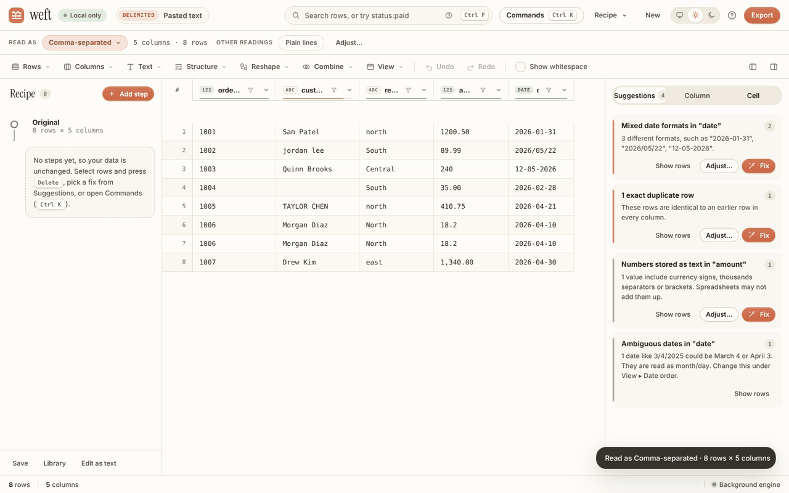

# Weft

Turn any pasted text into a clean table you can fix row by row and column by column. Every change is a visible, undoable step, and steps can be saved as recipes to reuse on the next file.



**Try it:** https://data-cleaner-coral.vercel.app

Weft is a rebuild of *Sift*. It runs entirely in the browser: no accounts, no uploads, and network access is blocked by a Content Security Policy.

## What it does

### Reading messy text
16 detectors, each with a plain-English explanation of how the text was read. Alternative readings appear as chips in the "Read as" bar.

- **Structured formats:** CSV/TSV/semicolon/pipe (with a consistency score), JSON, JSON lines, markdown tables, MySQL/psql box tables, and web tables copied from a browser (colspan and rowspan handled).
- **Column layouts:** fixed-width output such as `docker ps` or `ls -l`, and columns separated by runs of spaces (text copied from PDFs).
- **Records:** key: value blocks, and blocks of lines (addresses).
- **Logs:** logfmt, Apache/Nginx access logs, timestamped logs with level and source, and log lines ending in JSON.
- **Other:** bulleted lists, and plain lines as the fallback.
- **Clean-up detection:** title rows, the real header row, totals rows, page leftovers and repeated headers are found and offered as one-click fixes.
- **Reading dialog:** a live preview and settings for each reading, plus a ruler for fixed-width text. Click to add a column cut, click a cut to remove it, drag to move it; it also works from the keyboard.

### Cleaning
- **Selecting:** click rows, columns or cells; Shift and Ctrl/⌘ ranges; select all.
- **Deleting and keeping:** press Delete to remove rows, columns or cell contents; "Keep only selected".
- **Filtering:** "Remove rows like these" suggests a rule that matches your selected rows. The filter builder supports all/any, 15 comparisons, and a live preview of rows removed and kept.
- **33 step types:**
  - Rows: remove duplicates, remove empty rows, remove top/bottom rows, use a row as header, remove repeated headers, sort, split a cell's values into rows.
  - Columns: rename, delete, keep, duplicate, reorder, change type, fill blanks, fill down, merge, split, extract, split by structure (JSON, key-value, logfmt, fixed-width, pattern).
  - Text: trim, clean invisible characters, change case, find and replace, clean numbers, normalize dates.
  - Reshape: wide to long, long to wide, group and summarize.
  - Combine: join with a reference file, compare with a reference (diff).
- **Suggestions panel:** a problem list sorted by severity, each with Show rows, Adjust… and Fix.
- **Column tab:** type, empties, distinct values, min/max/average, and the most common values (click one to select those rows).
- **Cell tab:** the full value with whitespace made visible, and the history of how each step changed it.
- **Edit by example:** edit a cell, and Weft offers to apply the same change to similar cells.

### Recipes (saved pipelines)
- **Recipe panel:** a timeline of steps that can be muted, reordered (drag, or Alt+↑/↓), edited, duplicated and deleted. A step slider shows the data at any step.
- **Where new steps go:** new steps are inserted after the step you're viewing. Undo and redo cover every change.
- **Library:** save to the library in your browser, optionally with the result's shape so a future file that looks different gets a warning.
- **Applying to a new file:** columns renamed only by case, spaces or punctuation are matched automatically. If the recipe's reading doesn't fit the new file, you're asked which reading to use.
- **Sharing:** a compressed share link that carries only the steps (with a review gate), plus download and import of recipe files.
- **Recipe as text:** edit the recipe as text, one step per line, with error messages per line.
- **Autosave:** the recipe autosaves. Keeping the data itself in the browser (IndexedDB, up to 50 MB) is optional and off by default.

### Excel
- Opens .xlsx, .xlsm, .xlsb, .xls and .ods files using SheetJS 0.20.3 (`vendor/xlsx.full.min.js`). The library loads only when an Excel file is opened or exported, so startup is unaffected.
- Multi-sheet workbooks ask which sheet to clean. Merged cells are reported.
- "Download as Excel workbook" (and the Excel option in Export) writes numbers and ISO dates as real Excel values, turns on filters and sizes the columns. Text that starts with = + - @ is stored as text, so no formulas are ever created.
- Reference files for join and compare can also be Excel files.

### Performance
Help ▸ Measure performance times reading, trimming, sorting, filtering, searching, scrolling and undo on 200,000 generated rows, checks each against its budget, and reports page freezes (long tasks). "Copy report" gives a text summary.

### Output
Export as Excel (.xlsx), CSV, TSV, JSON records, JSON columns, NDJSON, Markdown or plain lines. You choose the rows (final result, current view, or selected rows) and the columns. Options include formula-injection protection, an Excel-friendly mode (BOM and Windows line endings), and "Copy for spreadsheet".

### Interface
- **Commands:** a palette (Ctrl/⌘K) with search that allows typos and understands synonyms ("delete" finds "remove", "unpivot" finds "wide to long"). It lists every command, and disabled ones show the reason.
- **Menus:** toolbar menus and right-click menus are built from the same command list. Long-press opens the menu on touch screens.
- **Keyboard:** full grid navigation and a `?` shortcuts sheet.
- **Large files:** the grid only draws visible rows, so it stays fast on 200,000-row files. The engine runs in a Web Worker and falls back to the main thread automatically.
- **Look:** System, Light and Dark themes (System by default, with a soft fade when switching), three row densities, reduced-motion support, and ARIA roles.

## What it does not do

- It makes no network requests. The Content Security Policy sets `connect-src 'none'`, so the page cannot send data anywhere.
- It does not keep your data between visits unless you turn on "Remember my data". That stores up to 50 MB in the browser's IndexedDB.
- High contrast has been looked over by eye only on the 3.0 surfaces (query bar, autocomplete, funnel panel, Find and Replace, the formula form, pinned columns and the distribution chart), not on every older screen, and no contrast ratios were measured.
- Column filters and pinned columns are not saved by "Remember my data"; filters reset when the page is reloaded and pins come back by file name.
- A query that mixes AND and OR without parentheses is still refused in a recipe line, as in 2.x; the query box accepts it, and "Make this a step" writes explicit parentheses.
- Relative filters (last N days, top N, above average) are view-only until you make them a step, when they become fixed values.
- A formula is a single line, and `TEXT` supports a limited set of formats (no scientific notation or multi-part formats).
- Occasional main-thread tasks of 50 to 70 ms still appear in some performance runs, as they did in 2.6.2.

## Privacy

Your text and files stay in the tab. The page cannot make network requests, and it loads no scripts, fonts or images from other sites. The recipe autosaves in the browser. The data is stored only if you turn on "Remember my data". The storage keys are listed under Data and storage.

## Built with

- **No framework and no build step.** Plain JavaScript in numbered files, loaded by `index.html`. The engine (`js/core/`) has no DOM access and runs in a Web Worker, with an automatic fallback to the main thread.
- **SheetJS 0.20.3**, vendored in `vendor/xlsx.full.min.js`, for Excel and OpenDocument files. It loads only when an Excel file is opened or exported.
- **Instrument Serif**, bundled in `fonts/` (SIL Open Font License), for headings. The UI uses the system sans.
- **Tests run in the browser:** `tests.html`, `ui-test.html` and `perf-test.html`.

## Entry points

| Path | Purpose |
|---|---|
| `index.html` | The app |
| `index.html#r=<code>` | Opens a shared recipe. The review dialog appears before anything runs. `#p=` links from Sift are also accepted. |
| `index.html?noworker=1` | Forces the engine onto the main thread (for debugging) |
| `file://` | Opening `index.html` straight from disk works, but the background worker cannot start (the engine runs on the main thread) and the browser blocks the font files. Serve the folder over http for the full experience. |
| `index.html?theme=dark` / `?theme=light` / `?theme=system` | Forces a theme for this visit (doesn't change the saved choice) |
| `index.html?contrast=high` / `?contrast=normal` | Forces a contrast level for this visit |
| `tests.html` | Engine tests: 1,137 checks (the 321 from 2.6.2, the 174 golden v2 recipe checks, and the new bug, query, condition-tree, column-filter, cache, formula and polish checks, including a 500-iteration query parity fuzz on three seeds) |
| `ui-test.html` | Runs the full UI end to end (354 checks, including theme, contrast, fill-bar filtering, tabs, joins between tabs, restore, the query bar, column filters, Find and Replace, formulas, pinned columns, the histogram and the what's new card) and logs results to the console |
| `perf-test.html` | Runs the 200,000-row performance test automatically (now including queries, distinct values, find next and formulas) and logs the timings |
| `tools/bench.html` | Times each engine stage on its own (parsing, steps, view, issues, export), with no UI |

## Data and storage
- **Table model:** columnar `{cols, data[c][r], n, rowIds}`. Each row has a stable ID that survives sorting, filtering and reordering.
- **Browser storage keys:**
  - `weft.session.v1`: the autosaved recipe.
  - `weft.library.v2`: saved recipes. Old `sift_library_v1` entries are migrated automatically.
  - `weft.prefs.v1`: settings, including `theme` (`system`, `light` or `dark`; missing means `system`), `contrast` (`system`, `high` or `normal`), density, date order, column widths and `pinned` (pinned column names by file name; missing means none).
  - `weft.recentCommands`, and `weft.tips.v1`, which holds the getting-started flag and, from 3.0, the dismissed what's new card (`whatsNew`). The old value `true` is still read as "getting started dismissed".
  - Each tab also keeps its column filters (`colFilters`) and pinned columns while the page is open. They are view state, not part of the recipe, and they are not saved to the browser database.
- **Optional data storage:** IndexedDB `weft-data/sessions`, used only if you turn on "Remember my data". With several tabs open it stores each tab's source text, recipe and reading (`v: 2`); with one tab it keeps the older single-table shape. Both shapes also keep the reference files used by joins and diffs.

## Run locally

```
python3 -m http.server 8000
```

Then open `http://localhost:8000`. Opening `index.html` from disk works, but the background worker cannot start and the browser blocks the font files.

More: [`docs/structure.md`](docs/structure.md) · [`docs/performance.md`](docs/performance.md) · [`docs/design.md`](docs/design.md) · [`CHANGELOG.md`](CHANGELOG.md)

## License

MIT. See `LICENSE`. Bundled third-party components keep their own licences.
